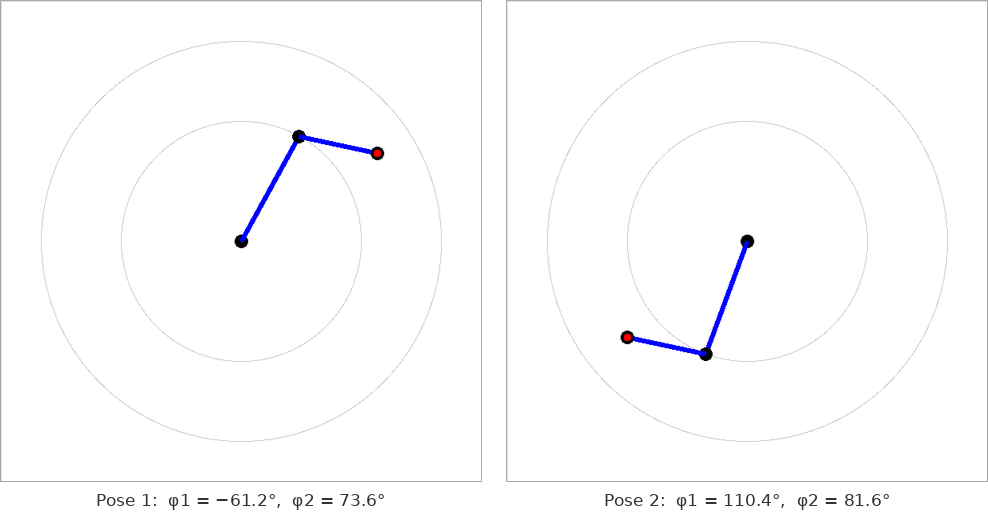
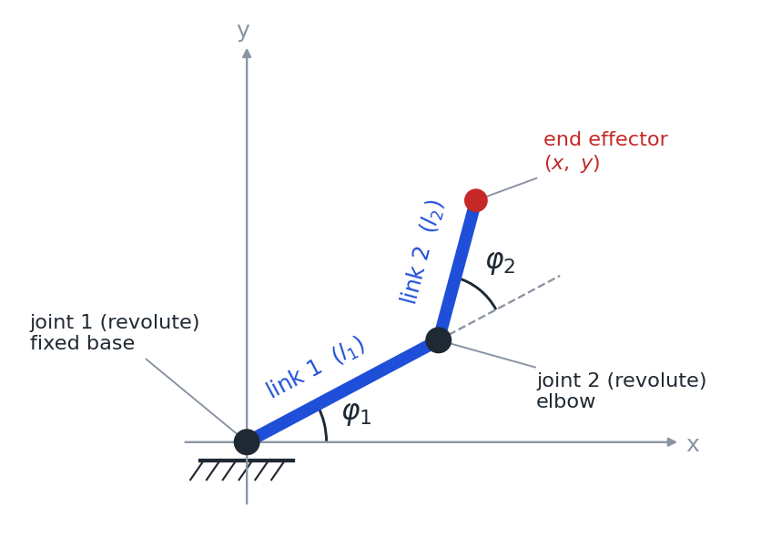
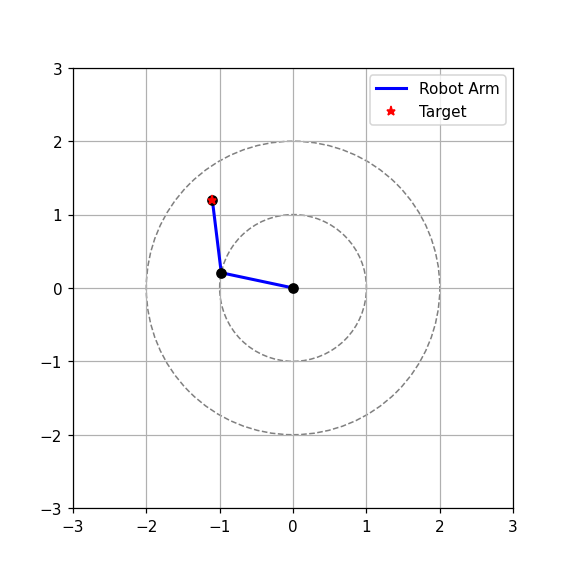

# Inverse Geometric Model of a Two-Link Planar Robot Arm


An interactive simulation of a planar **2R robot arm**: two links, two revolute joints, two
degrees of freedom. Click anywhere in the window and the arm moves its end effector to that point.

The project solves the **inverse geometric model** of the arm (*modèle géométrique inverse*, MGI):
given a position of the end effector, find the joint angles that reach it. It is solved in three
ways — Newton's method, a damped Newton's method that survives singularities, and the exact
closed-form solution — so the numerical and analytic approaches can be compared on the same
problem.



*The Tkinter app after two clicks. Red dot: target. Inner circle: path of the elbow. Outer circle:
maximum reach.*

## Table of contents

- [The robot](#the-robot)
- [Geometric model or kinematic model?](#geometric-model-or-kinematic-model)
- [The models](#the-models)
- [Three solvers](#three-solvers)
- [Comparison](#comparison)
- [Project structure](#project-structure)
- [Installation](#installation)
- [Usage](#usage)
- [Tests](#tests)
- [What the experiment shows](#what-the-experiment-shows)
- [License](#license)

## The robot



| Property | Value |
|---|---|
| Type | Serial planar manipulator, **2R** (also written RR) |
| Links | **2** rigid links, of lengths $l_1$ and $l_2$ |
| Joints | **2** revolute joints with parallel axes, perpendicular to the plane of motion |
| Degrees of freedom | **2** |
| Joint variables | $q = (\varphi_1, \varphi_2)$ |
| Task variables | $X = (x, y)$, the position of the end effector in the plane |
| Redundancy | None: 2 joint variables for 2 task variables |
| Base | Fixed, at the origin |
| Workspace | The ring $\lvert l_1 - l_2 \rvert \le \sqrt{x^2 + y^2} \le l_1 + l_2$ |

- **Joint 1** is at the base. It turns link 1 by $\varphi_1$, measured from the x-axis.
- **Joint 2** is the elbow, at the end of link 1. It turns link 2 by $\varphi_2$, measured from
  the direction of link 1 (a relative angle).
- The **end effector** is the free end of link 2. Only its position is controlled; with two
  degrees of freedom its orientation cannot be chosen independently.

The Tkinter app uses $l_1 = 150$ and $l_2 = 100$ pixels, the Matplotlib app $l_1 = l_2 = 1$.

## Geometric model or kinematic model?

Robotics courses in the French tradition distinguish two levels, which English-language texts
usually group under the single name *inverse kinematics*:

| Model | Relates | Question answered |
|---|---|---|
| Direct geometric model (MGD) | joint positions → end-effector position | Where is the end effector for these angles? |
| **Inverse geometric model (MGI)** | end-effector position → joint positions | **Which angles reach this point?** |
| Direct kinematic model (MCD) | joint velocities → end-effector velocity, $\dot X = J(q)\,\dot q$ | How fast does the end effector move? |
| Inverse kinematic model (MCI) | end-effector velocity → joint velocities, $\dot q = J(q)^{-1}\dot X$ | Which joint velocities give this motion? |

**This project works at the position level: it is an inverse geometric model.** There are no
velocities and no time in it. The Jacobian matrix $J$, which defines the kinematic model, does
appear, but only as a numerical tool: Newton's method uses it to solve the position equations
iteratively. The closed-form solver does not use it at all.

In the code, function names such as `forward_kinematics` and `newton_ik` follow the usual English
vocabulary.

## The models

**Direct geometric model** (forward kinematics). The position of the end effector as a function of
the joint angles:

```math
x = l_1\cos\varphi_1 + l_2\cos(\varphi_1+\varphi_2), \qquad
y = l_1\sin\varphi_1 + l_2\sin(\varphi_1+\varphi_2)
```

**Inverse geometric model.** Given a target $(x_t, y_t)$, find the angles. That is a system of two
non-linear equations in two unknowns. Written as a root-finding problem, we look for
$v = (\varphi_1, \varphi_2)$ with

```math
f(v) = \begin{pmatrix} l_1\cos\varphi_1 + l_2\cos(\varphi_1+\varphi_2) - x_t \\ l_1\sin\varphi_1 + l_2\sin(\varphi_1+\varphi_2) - y_t \end{pmatrix} = \begin{pmatrix} 0 \\ 0 \end{pmatrix}
```

**Number of solutions.** With $d$ the distance from the base to the target:

| Position of the target | Solutions |
|---|---|
| Inside the ring, $\lvert l_1 - l_2 \rvert < d < l_1 + l_2$ | 2, mirror images with the elbow on either side of the line base–target |
| On a boundary, $d = l_1 + l_2$ or $d = \lvert l_1 - l_2 \rvert$ | 1, arm fully stretched or fully folded |
| Outside the ring | None |

## Three solvers

All three live in [`src/kinematics.py`](src/kinematics.py), separate from any drawing code.

### 1. Newton's method

Newton's method improves a guess $v_n$ by linearizing $f$ around it:

```math
v_{n+1} = v_n - J(v_n)^{-1} f(v_n)
```

where $J$ is the Jacobian of the direct geometric model, the matrix of partial derivatives of the
end-effector position with respect to the joint angles:

```math
J = \begin{pmatrix} -l_1\sin\varphi_1 - l_2\sin(\varphi_1+\varphi_2) & -l_2\sin(\varphi_1+\varphi_2) \\ l_1\cos\varphi_1 + l_2\cos(\varphi_1+\varphi_2) & l_2\cos(\varphi_1+\varphi_2) \end{pmatrix}
```

The Jacobian is written out analytically and the linear system is solved with
`numpy.linalg.solve` rather than by inverting the matrix. Each solve starts from the arm's current
pose, and stops when the end effector is within the tolerance of the target or after 20
iterations.

Its determinant simplifies to

```math
\det J = l_1 l_2 \sin\varphi_2
```

so the method breaks down exactly when $\varphi_2 = 0$ or $\varphi_2 = \pi$: the arm is fully
stretched or fully folded, and no small change of the angles can move the end effector along the
arm. These are the **singular configurations**.

### 2. Damped Newton's method with singularity handling

The second variant makes two changes:

- **Damping.** Only half of the Newton step is taken, $v_{n+1} = v_n - 0.5\,J^{-1} f(v_n)$. Each
  step is shorter, so the method needs more of them, but it no longer overshoots when the starting
  pose is far from the solution.
- **Leaving singularities.** When $|\det J|$ falls below $10^{-10}$, the angles are nudged by a
  small random amount and the iteration continues, instead of dividing by nearly zero.

### 3. Closed-form solution

For two links the answer can be written down directly. The law of cosines gives the elbow angle
from the distance $d$ to the target:

```math
\cos\varphi_2 = \frac{d^2 - l_1^2 - l_2^2}{2\,l_1 l_2}
```

The two signs of $\varphi_2 = \pm\arccos(\cdot)$ are the two elbow configurations. For each one,
with $a = l_1 + l_2\cos\varphi_2$ and $b = l_2\sin\varphi_2$:

```math
\varphi_1 = \operatorname{atan2}\left(a\,y_t - b\,x_t,\; a\,x_t + b\,y_t\right)
```

The solver computes both and returns the one closest to the arm's current angles, so the arm
moves smoothly from click to click instead of flipping its elbow. Targets outside the workspace
are handled explicitly: the arm points at the target fully extended if it is too far, or fully
folded if it is too close.

## Comparison

`scripts/compare_solvers.py` sends each solver along the same path of 1,000 random reachable
targets. As in the apps, every solve starts from the pose reached for the previous target, so
consecutive targets are usually far apart. A target counts as reached when the end effector is
within 0.001 of it ($l_1 = 150$, $l_2 = 100$).

| Solver | Targets reached | Mean iterations | Mean position error |
|---|---|---|---|
| Closed form | 100.0% | — | 2.6 × 10⁻¹⁴ |
| Newton, 20 iterations max | 87.3% | 7.0 | 1.1 × 10⁻⁴ |
| Damped Newton (0.5), 100 iterations max | 100.0% | 19.1 | 7.1 × 10⁻⁴ |

The run is seeded, so these figures are reproduced exactly by the script.

## Project structure

```
two-link-arm-inverse-geometric-model/
├── src/
│   ├── kinematics.py        # direct geometric model, Jacobian, the three solvers (no GUI code)
│   ├── tkinter_app.py       # interactive app on a Tkinter canvas, solver selectable
│   └── matplotlib_app.py    # interactive app in a Matplotlib window, damped Newton
├── scripts/
│   └── compare_solvers.py   # the comparison table above
├── tests/
│   └── test_kinematics.py   # 14 tests of the kinematics module
├── assets/                  # screenshots used in this README
├── requirements.txt
├── LICENSE
└── README.md
```

## Installation

```bash
git clone https://github.com/Abdulkarem-SHAHEN/two-link-arm-inverse-geometric-model.git
cd two-link-arm-inverse-geometric-model

python -m venv venv
venv\Scripts\activate            # Windows
# source venv/bin/activate       # Linux / macOS

pip install -r requirements.txt
```

Tkinter is part of the standard Python installers on Windows and macOS. On Debian or Ubuntu,
install it with `sudo apt install python3-tk`.

## Usage

Run from the repository root.

**Tkinter app.** Link lengths are in pixels (150 and 100). Click anywhere on the canvas.

```bash
python src/tkinter_app.py                    # closed-form solver
python src/tkinter_app.py --solver newton    # Newton's method
```

With the closed-form solver, clicking outside the outer circle makes the arm stretch toward the
click. With Newton's method there is no solution to converge to, and the arm stops wherever the
last iteration left it — a direct way to see the difference between the two approaches.

**Matplotlib app.** Link lengths are 1 and 1. Click inside the outer circle; clicks outside it are
ignored with a warning in the terminal.

```bash
python src/matplotlib_app.py
```



In the Tkinter window the y-axis points down, as on any screen, so positive angles turn clockwise.
The Matplotlib window uses the usual mathematical orientation.

**Using the solvers directly:**

```python
import numpy as np
from kinematics import analytic_ik, newton_ik, forward_kinematics

target = np.array([170.0, -110.0])
result = analytic_ik(target, current_angles=np.array([0.5, 0.5]), l1=150, l2=100)

print(result.angles)                                   # [phi1, phi2] in radians
print(forward_kinematics(result.angles, 150, 100))     # back at the target
```

## Tests

```bash
pytest
```

The 14 tests check, among other things, that:

- the analytic Jacobian matches a finite-difference approximation, and its determinant equals
  $l_1 l_2 \sin\varphi_2$;
- the closed-form solver reaches each of 500 random reachable targets to within 10⁻⁸;
- the closed-form solver returns the elbow configuration closest to the current pose;
- unreachable targets give a fully extended or fully folded arm;
- Newton's method converges when started near the solution, and reports failure for an
  unreachable target;
- the damped variant recovers from a start in a singular configuration.

## What the experiment shows

- **A closed form, when it exists, is hard to beat.** It is exact, needs no iterations, never
  fails on a reachable target, and gives control over which of the two solutions is used.
- **Plain Newton is fast but fragile.** It needs about 7 iterations when it works, but missed
  about one target in eight on long jumps: far from the solution the linearization is poor, the
  full step overshoots, and 20 iterations are not always enough to recover.
- **Damping trades speed for reliability.** Half steps reached every target at the cost of roughly
  three times as many iterations.
- **Newton does not choose the solution.** It converges to whichever of the two elbow
  configurations its path leads to, which can make the arm flip between clicks. The closed-form
  solver avoids this by construction.
- **Why Newton still matters.** The closed form is specific to this arm. With more joints, or
  joints in three dimensions, the inverse geometric model usually has no formula, and iterative Jacobian-based methods like
  these are the standard approach. The two-link arm is the smallest case where the numerical
  method can be checked against an exact answer.

## License

Released under the [MIT License](LICENSE).
